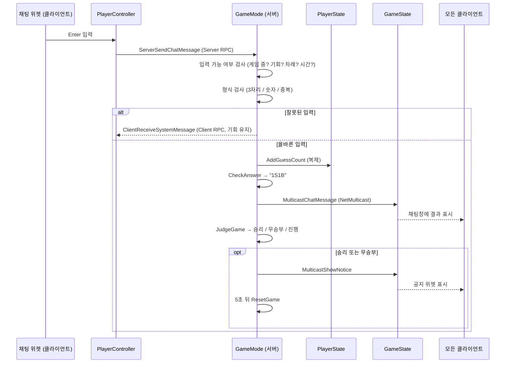

# ⚾ NumberBaseball — 멀티플레이 숫자 야구

언리얼 엔진 5.6 C++로 만든 서버-클라이언트 구조의 숫자 야구 게임입니다.
서버가 숨긴 3자리 숫자를 채팅으로 입력해 먼저 맞히는 사람이 이깁니다.

- 엔진: Unreal Engine 5.6
- 클래스 접두사: `NB` (NumberBaseball)
- 구현 범위: 필수 기능 전체 + 도전 기능(턴 제어, 타이머, 시간 초과 처리)

> 시연 영상: (제출 시 링크 또는 파일명을 적어 주세요)

---

## 1. 게임 규칙

| 항목 | 내용 |
| --- | --- |
| 정답 | 서버가 만든 1~9 사이의 중복 없는 3자리 숫자 |
| S (스트라이크) | 숫자와 자리가 모두 일치 |
| B (볼) | 숫자는 있지만 자리가 다름 |
| OUT | 일치하는 숫자가 하나도 없음 |
| 기회 | 플레이어당 3번 |
| 승리 | 3번 안에 먼저 3S를 달성 |
| 무승부 | 모든 플레이어가 기회를 다 썼는데 정답자가 없음 |
| 턴 | 한 번에 한 명만 입력, 제한 시간 15초. 시간 안에 입력하지 못하면 기회 1회 소진 |

채팅창에 **숫자로 시작하는 메시지**를 치면 숫자 야구 입력으로, 그 외에는 일반 채팅으로 처리합니다.

---

## 2. 실행 방법

1. `NumberBaseball.uproject`를 우클릭해 **Generate Visual Studio project files**를 실행하고, 솔루션을 빌드합니다. (또는 uproject를 더블클릭해 모듈을 리빌드)
2. 아래 [5. 위젯 블루프린트 만들기](#5-위젯-블루프린트-만들기)를 따라 위젯 블루프린트 3개를 만듭니다.
3. 에디터의 플레이 버튼 옆 메뉴에서
   - **Number of Players**: 2 이상
   - **Net Mode**: Play As Listen Server
   로 설정하고 플레이합니다.
4. 2명이 접속하면 3초 뒤 게임이 시작됩니다. 서버가 만든 정답은 **Output Log**에서 `LogNumberBaseball`로 확인할 수 있습니다.

GameMode는 `Config/DefaultEngine.ini`에서 `NBGameModeBase`로 지정되어 있어 어떤 레벨에서든 바로 동작합니다.

---

## 3. 설계: 누가 데이터를 가지고, 어떻게 전달하는가

### 클래스별 역할

| 클래스 | 존재하는 곳 | 가진 데이터 / 역할 |
| --- | --- | --- |
| `ANBGameModeBase` | 서버만 | 정답, 참가자 목록, 턴 순서. 모든 판정과 진행 |
| `ANBGameStateBase` | 서버 + 모든 클라이언트 | 라운드 단계, 현재 턴 플레이어, 남은 시간(복제). 채팅/공지 Multicast |
| `ANBPlayerState` | 서버 + 모든 클라이언트 | 현재 시도 횟수, 최대 시도 횟수(복제) |
| `ANBPlayerController` | 서버 + 본인 클라이언트 | 입력을 서버로 보내는 Server RPC, 본인 전용 안내를 받는 Client RPC, 위젯 생성 |
| `UNBBaseballLibrary` | 어디서나 | 정답 생성, 입력 검사, S/B 판정 (순수 함수) |
| `UNBChatWidget` / `UNBNoticeWidget` / `UNBTimerWidget` | 각 클라이언트 | 화면 표시만 담당 |

정답은 GameMode에만 있고 복제하지 않으므로 클라이언트는 정답을 알 방법이 없습니다.

### 데이터 흐름



### RPC와 복제를 나눈 기준

- **Server RPC** (`ServerSendChatMessage`): 클라이언트가 서버에 요청할 때. 클라이언트가 소유한 액터에서만 보낼 수 있어 PlayerController에 두었습니다.
- **Client RPC** (`ClientReceiveSystemMessage`): "다시 입력하세요"처럼 한 사람만 봐야 하는 안내.
- **NetMulticast RPC** (`MulticastChatMessage`, `MulticastShowNotice`): 채팅과 결과 공지처럼 순간적으로 모두에게 알리는 이벤트. 모든 클라이언트에 존재하는 GameState에 두었습니다.
- **Property Replication** (남은 시간, 현재 턴, 시도 횟수): 계속 유지되는 상태. 나중에 접속한 사람도 최신 값을 받습니다.

---

## 4. 구현 과정

### 필수 1. GameMode의 판정 로직

- **채팅**: 위젯 → `ServerSendChatMessage` → `ANBGameModeBase::HandleChatMessage` → `MulticastChatMessage` 순서로 중계합니다. 서버에서 공백 제거, 빈 메시지 무시, 길이 제한(100자)을 먼저 적용합니다.
- **정답 생성** (`GenerateRandomNumbers` → `UNBBaseballLibrary::GenerateSecretNumber`): 1~9를 `TArray`에 담고, 무작위로 하나를 뽑을 때마다 `RemoveAtSwap`으로 후보에서 제거합니다. 뽑은 숫자가 후보에서 사라지므로 중복이 생기지 않고 재시도 루프도 필요 없습니다.
- **입력 검사** (`ValidateGuess`): 숫자 여부 → 3자리 → 0 포함 여부 → 중복(`TArray::Contains`) 순으로 검사하고 `ENBGuessValidation`으로 결과를 돌려줍니다. 실패하면 사유에 맞는 안내("3자리 숫자를 입력해주세요. 다시 입력하세요." 등)를 본인에게만 보내고 기회는 그대로 둡니다.
- **판정** (`CheckAnswer` → `JudgeGuess`, `MakeResultString`): 같은 자리의 숫자가 같으면 S, 아니면 정답 배열에 `Contains`로 들어 있는지 확인해 B를 셉니다. 둘 다 0이면 `"OUT"`, 아니면 `"1S1B"` 형태로 만듭니다.

### 필수 2. PlayerState의 시도 횟수 관리

- `CurrentGuessCount`, `MaxGuessCount(기본 3)`를 `Replicated`로 선언했습니다. 값은 서버의 `AddGuessCount()`에서만 바뀝니다.
- Getter: `GetCurrentGuessCount()`, `GetMaxGuessCount()`, `GetRemainingGuessCount()`, `HasRemainingChance()`, `GetGuessCountString()`(`"[1 / 3]"`).
- 숫자를 입력할 때마다 결과와 함께 `Player1: 123 → 0S1B [1 / 3]`처럼 출력하고, 채팅 위젯 상단에도 내 시도 횟수를 표시합니다.

### 필수 3. 승리, 무승부, 리셋

- **결과 판단** (`JudgeGame`): 방금 입력의 스트라이크가 3이면 `Win`, 모든 참가자의 `HasRemainingChance()`가 false면 `Draw`, 아니면 `InProgress`를 돌려줍니다.
- **공지** (`FinishRound`): `MulticastShowNotice`로 모든 클라이언트의 공지 위젯에 "Player2 승리! (정답: 386)" 또는 "무승부! (정답: 386)"을 띄웁니다.
- **리셋** (`ResetGame`): 공지가 떠 있는 5초 뒤 타이머, 턴 정보, 모든 플레이어의 시도 횟수를 초기화하고 정답을 새로 만들어 게임을 다시 시작합니다.

### 도전 1. 턴 제어

- **시간 동기화**: 서버의 `TickTurnTimer`가 1초마다 `ANBGameStateBase::RemainingTurnTime`을 줄입니다. 이 값은 복제되고, 타이머 위젯은 스스로 시간을 세지 않고 이 값만 읽어 표시하므로 모든 플레이어가 같은 시간을 봅니다.
- **타이머 위젯**: 남은 초, 게이지(ProgressBar), 누구의 차례인지를 보여 줍니다.
- **입력 차단** (`CanAcceptGuess`): 서버가 `bTurnInputOpen`과 남은 시간을 확인해, 시간이 0초가 된 뒤의 입력은 "시간이 종료되어 입력할 수 없습니다."로 거절합니다. 자기 차례가 아닌 입력, 기회를 다 쓴 뒤의 입력도 같은 함수에서 거절합니다. 클라이언트 UI가 아니라 서버에서 막기 때문에 우회할 수 없습니다.

### 도전 2. 미입력 시 기회 소진과 턴 전환

- **활동 체크**: `ANBPlayerState::bHasGuessedThisTurn`. 턴이 시작될 때 false로 초기화하고 올바른 숫자를 입력하면 true가 됩니다.
- **시간 초과** (`HandleTurnTimeout`): 이 변수가 false인 채로 0초가 되면 `AddGuessCount()`로 기회를 1회 소진시키고 모두에게 알립니다.
- **턴 전환** (`EndCurrentTurn` → `StartNextTurn`): 숫자를 입력했거나 시간이 끝나면 1.5초 뒤 `FindNextTurnIndex`로 기회가 남은 다음 플레이어를 찾아 턴을 넘깁니다. 기회를 다 쓴 플레이어는 건너뜁니다.

### 추가로 처리한 예외 상황

| 상황 | 처리 |
| --- | --- |
| `abc`처럼 숫자가 아닌 입력 | 일반 채팅으로 중계 |
| `12`, `1234` | "3자리 숫자를 입력해주세요." (기회 유지) |
| `12a` | "숫자만 입력해주세요." (기회 유지) |
| `112` | "중복되지 않은 숫자를 입력해주세요." (기회 유지) |
| `102` | "1~9 사이의 숫자만 사용할 수 있습니다." (기회 유지) |
| 기회를 다 쓴 뒤 입력 | "기회를 모두 사용해 더 이상 입력할 수 없습니다. [3 / 3]" |
| 내 차례가 아닐 때 입력 | "지금은 Player2 님의 차례입니다." |
| 게임 시작 전 / 결과 공지 중 입력 | "지금은 게임이 진행 중이 아닙니다." |
| 자기 턴인 플레이어가 나감 | 즉시 다음 플레이어에게 턴을 넘김 |
| 인원이 최소 인원 아래로 줄어듦 | 게임을 멈추고 대기 상태로 전환 |

### 조절할 수 있는 값 (`ANBGameModeBase`)

`MinPlayersToStart(2)`, `StartDelay(3초)`, `RestartDelay(5초)`, `bUseTurnSystem(true)`, `TurnDuration(15초)`, `TurnTransitionDelay(1.5초)`.
`bUseTurnSystem`을 끄면 턴과 타이머 없이 누구나 아무 때나 입력하는 필수 기능만의 방식으로 동작합니다.

---

## 5. 위젯 블루프린트 만들기

C++ 부모 클래스가 `BindWidget`으로 위젯을 찾기 때문에 **이름이 정확히 같아야** 합니다.
`Content/UI` 폴더에 아래 3개를 만듭니다. (User Interface → Widget Blueprint → 부모 클래스 선택)

| 위젯 블루프린트 | 부모 클래스 | 배치할 위젯 (이름 = 종류) |
| --- | --- | --- |
| `WBP_NBChat` | `NBChatWidget` | `ChatScrollBox` = Scroll Box (필수)<br>`ChatInputBox` = Editable Text Box (필수)<br>`GuessCountText` = Text (선택) |
| `WBP_NBNotice` | `NBNoticeWidget` | `NoticeText` = Text (필수) |
| `WBP_NBTimer` | `NBTimerWidget` | `TimerText` = Text (필수)<br>`TurnText` = Text (선택)<br>`TimerBar` = Progress Bar (선택) |

배치 예시
- `WBP_NBChat`: Canvas Panel 왼쪽 아래에 Vertical Box → `GuessCountText`, `ChatScrollBox`(높이 300 정도), `ChatInputBox` 순서
- `WBP_NBNotice`: 화면 중앙에 큰 글씨의 `NoticeText`
- `WBP_NBTimer`: 화면 위쪽 중앙에 `TurnText`, `TimerText`, `TimerBar`

필수 위젯의 이름이 다르면 위젯 블루프린트 컴파일 시 오류로 알려 줍니다.
경로나 이름을 다르게 만들고 싶다면 `NBPlayerController`를 상속한 블루프린트에서 `Chat/Notice/Timer Widget Class`를 바꾸면 됩니다.

---

## 6. 프로젝트 구조

```
Source/NumberBaseball
├─ Public | Private
│  ├─ Game      NBGameModeBase, NBGameStateBase
│  ├─ Player    NBPlayerController, NBPlayerState
│  ├─ Library   NBBaseballLibrary
│  └─ UI        NBChatWidget, NBNoticeWidget, NBTimerWidget
└─ NumberBaseball.Build.cs
```

---

## 7. 테스트 체크리스트

- [ ] 2인 접속 후 3초 뒤 "새 게임 시작" 메시지와 함께 Player1의 턴이 시작된다
- [ ] Output Log에 서버의 정답이 찍힌다
- [ ] 일반 채팅이 모든 창에 보인다
- [ ] 정답이 386일 때 `127 → OUT`, `167 → 0S1B`, `386 → 3S0B`
- [ ] `12`, `112`, `12a` 입력 시 안내가 본인에게만 보이고 시도 횟수가 그대로다
- [ ] 숫자를 입력하면 `[1 / 3]`처럼 시도 횟수가 올라간다
- [ ] 모든 창의 타이머가 같은 숫자를 보여 준다
- [ ] 내 차례가 아닐 때 숫자를 입력하면 거절된다
- [ ] 15초 동안 입력하지 않으면 기회가 1회 소진되고 턴이 넘어간다
- [ ] 3S를 맞히면 승리 공지가 뜨고 5초 뒤 새 게임이 시작된다
- [ ] 모두 기회를 다 쓰면 무승부 공지가 뜨고 새 게임이 시작된다
